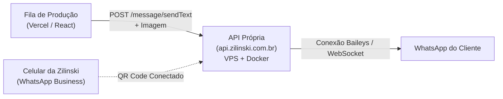

# 🚀 Plano de Ação: Implantação da API Própria de WhatsApp (Evolution API) & Integração com o Sistema Zilinski

Este documento define a arquitetura, etapas de instalação no seu servidor VPS Linux (com Docker) e a integração direta com a **Fila de Produção** da Calculadora Zilinski.

---

## 🏗️ 1. Arquitetura da Solução



- **Servidor:** VPS Linux (Ubuntu / Debian) com Docker e Docker Compose.
- **Endereço Seguro:** Subdomínio com SSL/HTTPS (ex: `https://api.zilinski.com.br` ou `https://whatsapp.zilinski.com.br`).
- **Engine:** [Evolution API v2](https://github.com/EvolutionAPI/evolution-api) (Open Source, sem limite de mensagens, suporte a envio de texto, mídia/imagens e webhooks para sites futuros).
- **Consumo:** O sistema Zilinski chamará um endpoint seguro passando o telefone do cliente, o texto da etapa e o link da imagem de cuidados quando aplicável.

---

## 🛠️ 2. Passo a Passo de Instalação na VPS (Guia Prático)

### Passo 2.1: Acessar a VPS via SSH
No seu terminal (ou PuTTY / PowerShell):
```bash
ssh root@SEU_IP_DO_SERVIDOR
```

### Passo 2.2: Instalar Docker e Docker Compose (se ainda não tiver)
```bash
curl -fsSL https://get.docker.com | bash
apt-get install -y docker-compose-plugin
```

### Passo 2.3: Criar a pasta e o arquivo `docker-compose.yml`
```bash
mkdir -p /root/evolution-api
cd /root/evolution-api
nano docker-compose.yml
```

Cole o conteúdo abaixo:

```yaml
version: '3.8'

services:
  evolution-api:
    image: atendai/evolution-api:v2.1.2
    container_name: evolution_api
    restart: always
    ports:
      - "8080:8080"
    environment:
      - SERVER_URL=https://api.zilinski.com.br
      - AUTHENTICATION_API_KEY=ZILINSKI_CHAVE_SUPER_SECRETA_2026
      - DATABASE_ENABLED=false
      - REDIS_ENABLED=false
      - LOG_LEVEL=ERROR,WARN,INFO
      - DEL_INSTANCE=false
    volumes:
      - evolution_instances:/evolution/instances

volumes:
  evolution_instances:
```
> *(Substitua `SERVER_URL` pelo seu subdomínio e troque `AUTHENTICATION_API_KEY` por uma chave segura de sua escolha)*.

### Passo 2.4: Iniciar a Evolution API
```bash
docker compose up -d
```

### Passo 2.5: Configurar o Subdomínio e SSL (Nginx Reverse Proxy / Cloudflare)
Se estiver usando Cloudflare:
1. Aponte o registro DNS tipo **A** do subdomínio `api.zilinski.com.br` para o IP da VPS com o proxy ativado (nuvem laranja).
2. Configure um reverse proxy simples no Nginx direcionando para `http://localhost:8080`.

---

## 📱 3. Conexão do WhatsApp da Empresa (Geração do QR Code)

### Passo 3.1: Criar a Instância da Zilinski
Execute uma chamada POST simples (via Postman, cURL ou script) para criar a instância:
```bash
curl -X POST https://api.zilinski.com.br/instance/create \
  -H "apikey: ZILINSKI_CHAVE_SUPER_SECRETA_2026" \
  -H "Content-Type: application/json" \
  -d '{
    "instanceName": "zilinski-principal",
    "integration": "WHATSAPP-BAILEYS",
    "qrcode": true
  }'
```

### Passo 3.2: Ler o QR Code
1. Acesse: `https://api.zilinski.com.br/instance/connect/zilinski-principal` no navegador.
2. Abra o WhatsApp no celular da Zilinski > **Aparelhos Conectados** > **Conectar um aparelho**.
3. Aponte a câmera para o QR Code na tela.
4. **Pronto!** O número estará 100% integrado à sua API própria.

---

## 💻 4. Integração no Sistema da Zilinski (`calculadora-de-escadas`)

### 4.1. Variáveis de Ambiente no Vercel:
Adicionar no painel da Vercel:
- `VITE_WHATSAPP_API_URL` = `https://api.zilinski.com.br`
- `VITE_WHATSAPP_INSTANCE` = `zilinski-principal`
- `WHATSAPP_API_KEY` = `ZILINSKI_CHAVE_SUPER_SECRETA_2026`

### 4.2. Fluxo Automatizado na Fila de Produção:
Quando o card do cliente for movido para uma nova etapa em `ProductionQueuePage.tsx`:
1. O sistema verifica se há telefone cadastrado para o cliente.
2. O sistema formata o número para o padrão internacional (`55 + DDD + Telefone`).
3. Dispara a mensagem personalizada de cada etapa via endpoint:
   - `POST /message/sendText/zilinski-principal`
4. Na etapa **Instalação confirmada — orientações finais**, dispara também o endpoint de mídia:
   - `POST /message/sendMedia/zilinski-principal` enviando a imagem do infográfico `cuidados-com-sua-escada.png`.

---

## 🎯 5. Benefícios para Futuros Sites e Projetos
- Uma única VPS atenderá a calculadora atual, o site institucional, chatbots de pré-atendimento e qualquer painel administrativo futuro.
- Zero dependência de mensalidades por mensagem ou limites de envio de terceiros.
- Total privacidade das conversas dos seus clientes dentro do seu próprio servidor.
